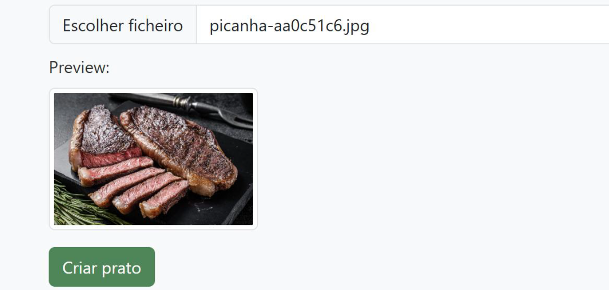
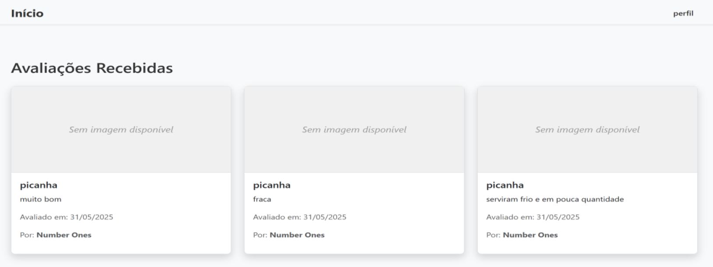
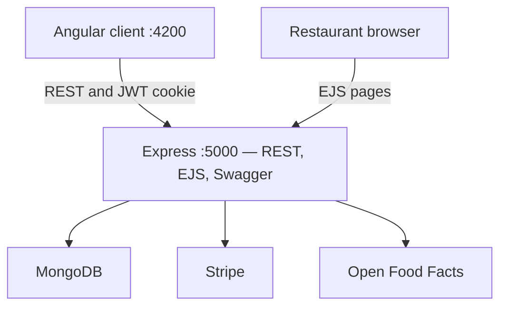

# Snackify — Restaurant Ordering Platform

A full-stack web application where restaurants publish menus and manage orders, while customers search restaurants, build a basket, place orders, and review meals. Includes a Swagger-documented REST API, restaurant back office, Angular client, and Stripe test payments.

A group assignment for **Web Application Programming**, in the second year of the BSc in Computer Engineering at ESTG – Polytechnic of Porto (2024/25), reviewed in 2026.

[](https://github.com/fmpoliveira05-jpg/snackify/actions/workflows/ci.yml)

## Team

- Francisco Oliveira — [@fmpoliveira05-jpg](https://github.com/fmpoliveira05-jpg)
- franciscom0rais
- PedroIUrt3

The original group repository's commit history has been preserved.

**My contribution:** initial project structure and data model; registration/authentication, menu management, and administrator restaurant approval; Open Food Facts and Stripe integration; Google Charts dashboards; and the initial Angular client. After submission, I completed the 2026 security review, tests, and missing features described below.

## Assignment overview

- Register/authenticate customers and restaurants; an **administrator approves** restaurants before they can operate.
- Menus contain **at most 10 dishes**, with categories, photos, nutritional information, and price per serving.
- Baskets **expire after 10 minutes**; calculate totals and notify restaurants of completed orders.
- Customers may **cancel within five minutes**, provided preparation has not started. **Five cancellations in a month block ordering for two months**.
- Restaurants track preparation, dispatch, and delivery.
- Customers can review delivered orders with a comment and photo.

Required stack: Node.js/Express, MongoDB, EJS for the first milestone, Angular client, and Swagger-documented REST services.

## Features

| Customer | Restaurant | Administrator |
|---|---|---|
| Search/sort restaurants by name/location and dishes by text, category, restaurant, location, and price | Create/edit dishes and menus, maximum 10 dishes | Approve/deactivate restaurants |
| Dish pages with image, category, Nutri-Score, calories, and allergens | Automatic nutrition information from [Open Food Facts](https://world.openfoodfacts.org/) | Manage categories |
| Basket with a 10-minute countdown | Configure preparation/delivery times, delivery radius, and concurrent-order limits | |
| Delivery, collection, or dine-in; Stripe test payments or on-site payment with order code and ID | New-order alerts in profile and back office | |
| Buy meal vouchers for yourself or another customer; spend their balance | Track orders and read reviews | |
| Cancel, review with a photo, inspect history, and manage profile | Order-status charts with Google Charts | |

All assignment bonus features are implemented: dashboard charts, external payment API, countdown basket, meal vouchers, and Open Food Facts integration.

### Screenshots

| Restaurant dish creation | Restaurant reviews |
|---|---|
|  |  |

## Architecture



```text
backend/
  app.js             Express configuration exported for tests
  server.js          MongoDB connection and server startup
  config/            Environment configuration and validation
  routes/            Routes and Swagger annotations
  controllers/       Route handlers
  services/          Business rules: cancellations, blocks, states, totals, restaurants,
                     search, vouchers, payments, capacity, caching, GDPR, cleanup
  models/            Mongoose schemas and validation
  middlewares/       Authentication, roles, uploads, validation, errors
  views/ public/     EJS restaurant back office
  tests/             Jest/Supertest tests without a database
  tests-integracao/  Real MongoDB tests: concurrency, GDPR, explain
  tests-navegador/   Chromium browser-storage and cookie tests
frontend/            Angular 20 standalone client
scripts/             MongoDB backup/restore and restore tests
docs/                Manual, operations, GDPR, costs
```

## Run locally

Requires **Node.js 20+** and **MongoDB**, locally, in Docker, or through Atlas. The examples use Bash.

```bash
git clone https://github.com/fmpoliveira05-jpg/snackify.git
cd snackify

# Optional database setup if you do not already have MongoDB
cp .env.example .env     # Set MONGO_ROOT_PASSWORD
docker compose up -d    # Authenticated MongoDB on 127.0.0.1:27017 only

# API
cd backend
cp .env.example .env     # Set JWT_SECRET, MONGODB_URI, and other required values
npm install
npm run seed            # Create administrator and categories
npm run dev             # http://localhost:5000; Swagger: /api-docs
```

In another terminal, start from the repository root:

```bash
cd frontend
npm install
npm start               # http://localhost:4200
```

With Docker Compose, use `MONGODB_URI=mongodb://snackify:<MONGO_ROOT_PASSWORD>@127.0.0.1:27017/snackify?authSource=admin` in `backend/.env`.

For online test payments, set a Stripe test key (`sk_test_...`) and use test card `4242 4242 4242 4242`. Without a key, on-site payments still work. Vouchers require Stripe or development-only `ALLOW_SIMULATED_PAYMENTS=true`.

Email verification is required after registration. Without SMTP in development, the backend console prints the verification link.

The [user manual](docs/MANUAL.md) covers each user workflow.

## Tests

Run from the repository root:

```bash
(cd backend && npm test)                 # 243 tests without a database
(cd backend && npm run test:integracao)  # 39 tests against real MongoDB
(cd backend && npm run test:navegador)   # Chromium; Angular build required
(cd backend && npm run carga)           # autocannon load test
(cd frontend && npm run test:ci)        # 59 Angular tests
scripts/testar-backup-restauro.sh        # Backup, restore, data comparison
```

Backend unit tests cover rules, API behaviour, security, cache, quotas, GDPR, and errors. Angular tests cover services, guards, components, interceptors, and state.

Integration, browser, and load tests start a disposable Docker `mongo:7` with in-memory data, removed afterwards. `MONGO_TEST_URI` can point to an existing test database. GitHub Actions runs unit/integration tests, builds production Angular, verifies source maps are absent, runs `npm audit`, and scans history with gitleaks.

## Operations

See [docs/OPERACAO.md](docs/OPERACAO.md).

- **Health:** `GET /health/live` for process health and `/health/ready` for MongoDB readiness, without secrets or request quotas.
- **Monitoring:** `uptime.yml` checks repository variable `SNACKIFY_HEALTH_URL` every 15 minutes and opens an issue on failure; absent configuration disables it. The original operations guide recommends an external primary monitor such as UptimeRobot or Better Stack.
- **Backups:** `scripts/backup.sh` creates timestamped compressed mongodump files, SHA-256 checksums, `BACKUP_KEEP` retention, and optional age/GPG encryption; `scripts/restore.sh` restores them. The restore test compares the recovered data.
- **Load:** recorded scenarios use 100 connections for 20 seconds with no errors; results are in the operations guide.
- **Shutdown/timeouts:** SIGTERM drains requests and closes MongoDB; server, database, Stripe, SMTP, and Angular have timeouts.
- **Indexes:** run `npm run indices` after deployments changing indexes.
- **GDPR cleanup:** hourly task; `npm run limpeza` runs it once.
- **Errors:** Angular/back-office 404 pages, JSON API 404s, and a 500 page without internal details.
- **Cache:** in-memory catalogue/Open Food Facts cache, one-year Angular asset caching, and API `no-store`.

## Limits

Configurable in `backend/.env`; defaults are:

| Limit | Default | Variable |
|---|---|---|
| API requests per IP | 300 / 15 minutes | `RATE_LIMIT_API_MAX`, `RATE_LIMIT_API_WINDOW_MINUTES` |
| Login attempts per IP | 20 / 15 minutes | `RATE_LIMIT_LOGIN_MAX` |
| Registrations per IP | 10 / hour | `RATE_LIMIT_REGISTER_PER_HOUR` |
| Password reset / verification resend per IP | 5 / hour | — |
| Orders per account | 20 / hour | `QUOTA_ORDERS_PER_HOUR` |
| Payments / voucher purchases per account | 30 / hour | `QUOTA_PAYMENTS_PER_HOUR` |
| Uploads per account | 30 / hour | `QUOTA_UPLOADS_PER_HOUR` |
| Dish creates/edits per account | 60 / hour | `QUOTA_DISH_WRITES_PER_HOUR` |
| Data exports per account | 5 / day | `QUOTA_EXPORTS_PER_DAY` |
| Open Food Facts requests per instance | 10 / minute | `OFF_MAX_REQUESTS_PER_MINUTE` |
| Emails per instance / recipient | 300 / 5 per day | `MAIL_MAX_PER_DAY`, `MAIL_MAX_PER_ADDRESS_PER_DAY` |
| JSON/form body | 100 KB | — |
| Image upload | One file, 2 MB; JPG/PNG/WEBP/GIF | — |
| List page size | Default 50, maximum 100; `?pagina=&limite=`, total in `X-Total-Count` | — |

Exceeding quotas returns 429 with `RateLimit-*` headers. Stripe webhooks and health checks are excluded. Counters are per instance. See [cost controls](docs/CUSTOS.md) for alerts and spending caps.

## GDPR

[docs/RGPD.md](docs/RGPD.md) records processing activities, security controls, and the breach-response process, including the applicable notification timelines described in the original project documentation.

- **Privacy policy:** `/privacidade`, linked from Angular, the back office, and registration; describes controller, data, purposes, legal bases, retention, processors, transfers, rights, and complaints to Portugal's CNPD.
- **Registration:** mandatory, unchecked policy checkbox; stores `PRIVACY_POLICY_VERSION` and acceptance timestamp. No marketing feature or separate marketing consent.
- **Access/portability:** profile data download, `GET /user/perfil/exportar`, returns JSON.
- **Deletion:** password-confirmed `POST /user/perfil/eliminar`; orders are pseudonymised for the sales-document retention obligation described in the GDPR guide.
- **Rectification:** edit profile.
- **Retention:** delete unverified accounts after seven days, including a TTL index; remove expired tokens; remove order identity documents after 30 days; delete unpaid vouchers after two days.
- **Cookies:** only the essential session cookie; no localStorage. Bootstrap/fonts are served locally; Google Charts loads only on the chart page.

## Security fixes in the 2026 review

The submitted application worked, but a security-focused review found serious issues:

- **Repository credentials:** `.env` with MongoDB Atlas credentials, JWT secret, and Stripe key was removed from history and replaced by `.env.example`.
- **Privilege escalation:** profile updates accepted arbitrary fields such as `userType: "admin"`; restaurants could register with `isChecked: true`. Updates now accept explicit allowlisted fields.
- **IDOR:** users could change other orders, view other customers' orders, and edit/delete other restaurants' dishes. Resource ownership is now checked.
- **Payments:** Stripe prices came from the browser, and visiting the success URL marked an order paid. Prices now come from the database; sessions are verified with Stripe.
- **Data exposure:** listings returned password hashes, tax IDs, and unapproved accounts. Passwords use `select: false`; responses expose only necessary fields.
- **NoSQL injection/brute force:** login accepted objects such as `{"$ne": null}` and had no rate limit. Added Mongoose `sanitizeFilter`, field-type checks, rate limiting, and uniform login errors.
- **Uploads:** arbitrary original-name files, including HTML, could be served from the application domain. Only images up to 2 MB with server-generated names are now accepted.
- **Stability:** asynchronous controller errors could terminate Node. Controllers now use `asyncHandler` and central error middleware.

Business-rule fixes included the cancellation block ending after one month instead of two and failing to prevent orders; missing menu-size validation during editing; reviews before delivery; skipped order states; restaurant charts counting all restaurants; and registration-image paths pointing to the wrong directory. Angular API addresses were consolidated from nine files into environment configuration.

## Security configuration and second review

All settings are documented in `backend/.env.example`.

- **Sessions:** HS256 JWT with issuer, audience, `jti`, and account version, held only in a `HttpOnly`, `SameSite=Strict` cookie. Production uses `Secure` and `__Host-snackify`; development uses `token`. Tokens are neither returned in response bodies nor accepted through `Authorization`. Password resets and `POST /auth/logout-all` invalidate all sessions. Production `JWT_SECRET` must contain at least 32 characters.
- **CSRF:** POST/PUT/PATCH/DELETE require an Origin or Referer matching `CLIENT_URL` or `SERVER_URL`.
- **Accounts:** email verification, single-use 30-minute reset links, a 15-minute lockout after five failures, and uniform errors. Passwords require 10–64 characters with upper/lowercase, number, and symbol; bcrypt cost 12. Email tokens are stored as SHA-256 hashes.
- **Paid vouchers:** initially pending with no balance; activation requires Stripe confirmation on return or through a webhook. Previously simulated purchases granted spendable balance without payment.
- **Bots/abuse:** endpoint-specific and general API rate limits, registration honeypot, and Cloudflare Turnstile for registration/login/reset.
- **Headers:** per-request nonce CSP without inline scripts/event attributes, `X-Frame-Options: DENY`, Referrer/Permissions policies, HSTS and production HTTPS redirection, 100 KB bodies, and production Swagger disabled by default.
- **Uploads:** verify file signatures for JPEG/PNG/WEBP/GIF, use the detected extension, and serve with `nosniff` and sandbox CSP.
- **Errors/logs:** hide internal messages and exclude query strings, tokens, and passwords from logs.
- **Queries:** explicitly trust server-built operators (`$gt`, `$in`, etc.); `sanitizeFilter` had neutralised them, breaking order limits, cancellation blocks, and dish search.
- **Dependencies:** upgraded Angular to version 20 as part of the security review and removed unused `mongoose-validator`.

### Configure services

- **SMTP:** `SMTP_HOST`, `SMTP_PORT` (587/STARTTLS or 465 with `SMTP_SECURE=true`), `SMTP_USER`, `SMTP_PASS`, `MAIL_FROM`. Without SMTP, development prints emails; production logs a send failure without the link.
- **Stripe webhook:** in development:

  ```bash
  stripe listen --forward-to localhost:5000/api/stripe/webhook
  ```

  Copy the displayed `whsec_...` into `STRIPE_WEBHOOK_SECRET`. In production, configure `https://<domain>/api/stripe/webhook` for `checkout.session.completed`. Without the secret, webhooks return 503 and payment is confirmed only on the customer's return. See [Stripe CLI documentation](https://docs.stripe.com/stripe-cli).
- **Turnstile:** secret in `TURNSTILE_SECRET_KEY`; public key in `TURNSTILE_SITE_KEY` for EJS and `turnstileSiteKey` in `frontend/src/environments/*.ts`. An empty secret disables verification.
- **Administrator:** set a policy-compliant `ADMIN_PASSWORD` before `npm run seed`. Otherwise a random password is generated and displayed only outside production. Seeded accounts are email-verified.
- **`ALLOW_SIMULATED_PAYMENTS=true`:** development-only unpaid voucher purchases; always ignored in production.
- **`ENABLE_API_DOCS=true`:** enables production Swagger; always available outside production.
- **`TRUST_PROXY`:** number of proxies in front of the app, such as `1` behind Nginx or Render; required for correct IP limits and HTTPS redirection behind a proxy.

### Existing-data migration

Older accounts without verified email cannot log in. Review the accounts before marking them verified in mongosh:

```js
db.users.updateMany({ emailVerified: { $exists: false } }, { $set: { emailVerified: true } })
db.restaurants.updateMany({ emailVerified: { $exists: false } }, { $set: { emailVerified: true } })
```

Old vouchers without status cannot be used because they were created without payment. Activate only confirmed legitimate vouchers, for example `db.vouchers.updateOne({ code: "VALE-..." }, { $set: { status: "active" } })`.

## Missing assignment features added in 2026

- **Restaurant settings:** preparation/delivery times, maximum radius, concurrent-order capacity. Applied at order creation; Haversine distance is used when addresses have coordinates, and estimated preparation/delivery times are calculated.
- **Customer search/filter/sorting:** name, category, price, restaurant, location.
- **On-site payment:** order code and identity document associated with the order and visible to the restaurant.
- **Restaurant notification:** new-order alerts.
- **Meal vouchers:** bonus feature with refunded balance when an order is cancelled.
